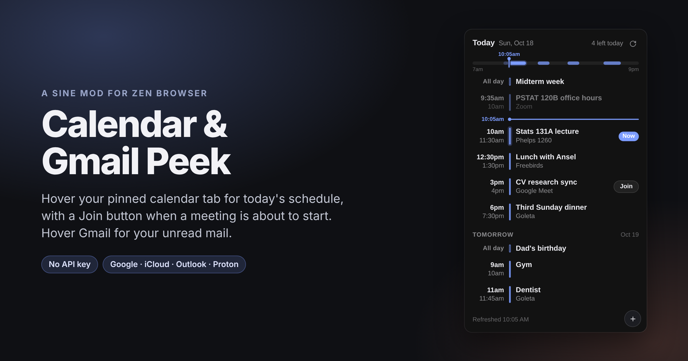

# Calendar & Gmail Peek

Arc's sidebar peeks for Zen: hover a pinned tab, see what matters, keep
going.

- **Calendar Peek** — hover a pinned Google Calendar, iCloud, Outlook, or
  Proton Calendar tab and today's schedule slides in: time, title, where it
  is, a now-line so you can see where you are in the day, and a **Join**
  button that lights up when a video call is about to start.
- **Gmail Peek** — hover a pinned Gmail tab and your unread mail appears:
  sender, subject, snippet, how long ago. Click one to open it, `+` to
  compose. This half is the Gmail integration from
  [Email Peek](https://github.com/malachyfernandez/email-peek) by
  malachyfernandez (MIT), restyled to match and with one bug fixed (see
  below).

Both are [Sine](https://github.com/CosmoCreeper/Sine) scripts in one mod.
Neither needs an API key.

## Calendar Peek

- **Where you are in the day.** A slim timeline strip shows the shape of
  today — a block per event, a marker for right now — and the list itself has
  a now-line: the last couple of finished events sit dimmed above it, what's
  ahead sits below. Earlier ones fold into a `3 earlier…` line.
- **Now / in 5 min.** The event you're in gets a `Now` chip and a glowing bar;
  anything starting within the hour counts down.
- **Join.** Meet, Zoom, Teams, Webex, Whereby… links are picked out of the
  event automatically. Within ten minutes of the start the button turns solid.
- **Tomorrow, too.** Shows today + tomorrow by default; set `days` to 1 for a
  pure today view or up to 14 for a week-and-change.
- **A badge on the tab** with the number of timed events still ahead of you.
- **Several calendars.** Add as many feeds as you like; each gets its own
  colour and the name shows under the event.
- **Compact-mode friendly.** In Zen's compact mode the sidebar holds still
  while the popup is open.

## Install

1. Install [Sine](https://github.com/CosmoCreeper/Sine) — the mod loader for
   Zen. No browser recompile needed.
2. In Zen: `Settings → Sine` → paste this repo's URL into the install field.
   If you had Email Peek installed, remove it — Gmail Peek is included here
   and the two would fight over the same tab.
3. Fully quit Zen and relaunch (Sine loads scripts at startup).
4. Pin your Gmail tab — that half just works. Pin your calendar tab (or drag
   it to Essentials) and hover it; the first time, the popup walks you
   through step 5.
5. Paste your calendar's **iCal address** into `Settings → Sine → Calendar
   & Gmail Peek → feeds`. Where to find it:

   | Service | Where the address lives |
   | --- | --- |
   | **Google Calendar** | Settings → *Settings for my calendars* → pick a calendar → **Secret address in iCal format** |
   | **iCloud** | Calendar → the share icon next to a calendar → *Public Calendar* → copy the `webcal://` link |
   | **Outlook.com** | Settings → Calendar → *Shared calendars* → *Publish a calendar* → copy the **ICS** link |
   | **Proton Calendar** | Calendar → ⋯ → *Share* → *Share with anyone* → copy the link |
   | **Fastmail** | Settings → Calendars → a calendar → *Subscribe* link |
   | **Canvas (school)** | Calendar → *Calendar Feed* (bottom right) |

   Separate multiple feeds with spaces. `webcal://` links are fine. To name
   one, prefix it: `School=https://…`.

That's it. There's no API key and no OAuth — the feed is a private URL your
calendar already serves, and the mod fetches it straight from the browser.

> **Why a feed and not "just read the tab"?** Google Calendar's web app is a
> wall of generated class names with no stable structure to scrape, and it
> unloads when the pinned tab sleeps. The iCal feed is a documented, stable
> format that every calendar service offers, so this works the same for all of
> them and keeps working through UI redesigns.

## Settings

In `Settings → Sine → Calendar & Gmail Peek` (or `about:config`):

### Calendar Peek

| Pref | Default | What |
| --- | --- | --- |
| `mod.calendarpeek.feeds` | — | One or more `.ics` addresses, space-separated. `Name=URL` to label one. |
| `mod.calendarpeek.days` | `2` | Days to show, starting today (1–14). |
| `mod.calendarpeek.max_items` | `8` | Events shown before a `+N more` line. |
| `mod.calendarpeek.show_past` | `true` | Show today's finished events, dimmed, above the now-line. |
| `mod.calendarpeek.show_badge` | `true` | Events-left-today badge on the tab icon. |
| `mod.calendarpeek.join_window` | `10` | Minutes before a call that Join turns solid. |
| `mod.calendarpeek.hover_delay` | `400` | ms before the preview opens. |
| `mod.calendarpeek.hide_delay` | `150` | ms before it closes on mouse-out. |
| `mod.calendarpeek.refresh_seconds` | `60` | Minimum gap between feed refreshes on hover. |
| `mod.calendarpeek.colors` | — | Colours per feed, in order (`#4285f4 #0b8043`). First feed uses Zen's accent otherwise. |
| `mod.calendarpeek.match` | — | Extra URL fragments that count as a calendar tab, e.g. `instructure.com/calendar`. |
| `mod.calendarpeek.require_pinned` | `false` | Only react to pinned / Essentials tabs. |
| `mod.calendarpeek.debug` | `false` | Log fetches and navigation to the Browser Console. |

### Gmail Peek

| Pref | Default | What |
| --- | --- | --- |
| `mod.gmailpeek.enabled` | `true` | Turn the Gmail half off (restart Zen). |
| `mod.gmailpeek.account` | `0` | Fallback account index when a tab URL has no `/u/N/`. |
| `mod.gmailpeek.max_items` | `6` | Emails shown in the popup. |
| `mod.gmailpeek.hover_delay` | `400` | ms before the preview opens. |
| `mod.gmailpeek.hide_delay` | `150` | ms before it closes on mouse-out. |
| `mod.gmailpeek.show_badge` | `true` | Unread badge on the tab icon. |
| `mod.gmailpeek.require_pinned` | `false` | Only react to pinned / Essentials tabs. |
| `mod.gmailpeek.debug` | `false` | Log to the Browser Console. |

Gmail Peek reads `https://mail.google.com/mail/u/N/feed/atom` with the
session you're already signed in with, and Multi-Account Container tabs
through that container's cookie jar. It needs Gmail signed in; it never
sees your password. Requires Sine (or fx-autoconfig).

## Under the hood

For the curious; nothing below is required reading.

- The mod `fetch()`es each feed from the chrome context (no cookies sent),
  parses the iCalendar text itself, and expands recurring events for the
  window you've asked for. Recurrence handles `FREQ=DAILY/WEEKLY/MONTHLY/
  YEARLY`, `INTERVAL`, `COUNT`, `UNTIL`, `BYDAY` (with ordinals like `-1FR`),
  `BYMONTHDAY`, `BYMONTH`, `BYSETPOS`, `WKST`, `EXDATE`, `RDATE` and
  `RECURRENCE-ID` overrides — enough for anything Google, Apple, or Outlook
  will export. Long-running series are fast-forwarded to the window, so a
  daily standup from 2015 costs nothing.
- Times are converted with `Intl` per event time zone, so a weekly 9 AM in
  Berlin stays 9 AM across a DST change. Outlook's Windows zone names
  (`Pacific Standard Time`) are mapped to IANA; unknown `TZID`s fall back to
  the feed's own `VTIMEZONE` offset.
- Join links come from `X-GOOGLE-CONFERENCE`, `X-MICROSOFT-
  SKYPETEAMSMEETINGURL`, `URL`, `LOCATION`, then the description, in that
  order.
- The timeline runs from 7 AM to 9 PM, stretching to cover anything earlier
  or later (and the current time). Blocks fade once they're over; the one
  you're in glows.
- Clicking an event opens that day in Google Calendar (`/r/day/YYYY/MM/DD`)
  or the event's own `URL` if the feed has one; `+` goes to Google's
  `eventedit` or Outlook's compose deeplink. Other providers just focus the
  tab.
- Feeds are cached in memory, refreshed on hover when older than
  `refresh_seconds`, and every five minutes in the background for the badge.
  A feed that fails keeps its last good copy; the popup says which one broke.
- Zen's native tab tooltip is suppressed while the popup is open, the same
  way Email Peek does it.

### What changed from Email Peek

- Only the Gmail script is included (no Proton/Outlook/iCloud halves).
- The popup is restyled to match Calendar Peek.
- The diagnostics system that wrote `email-peek.log` into your profile and
  added an "About Email Peek" item to the Tools menu is replaced by an
  opt-in Browser Console log (`mod.gmailpeek.debug`).
- **Bug fix:** the upstream script scans the feed body for
  `accounts.google.com` to detect a login redirect — but Google's own
  security alerts are sent from `no-reply@accounts.google.com`, so any
  unread "New sign-in" email made the popup insist you were signed out
  (and signing in again produced another alert). The check now only runs
  when the response isn't an Atom feed.

### Developing

The parsing/recurrence core is pure and unit-tested; the popup can be
rendered in an ordinary browser without Zen.

```sh
npm test                      # recurrence, time zones, overrides…
npm run check                 # syntax-check both scripts
python3 preview/shot.py       # regenerates preview PNGs and cover.png (needs playwright)
```

`preview/preview.html` and `preview/preview-gmail.html` load the real
`.uc.js` files with a few stubbed chrome globals, so what you see there is
what Zen renders.

## Known limitations

- Google's secret iCal feed can lag the web UI by a few minutes after an edit
  (Google caches it on their side).
- Shared calendars appear in your feed only if they're in *your* list of
  calendars with their own secret address — add each one as a separate feed.
- Gmail's Atom feed only lists unread mail in the inbox, so the popup is an
  unread list, not the whole inbox.
- Zen updates can wipe the Sine bootloader; reinstall Sine if mods vanish.

## License

MIT. `gmail-peek.uc.js` is derived from
[Email Peek](https://github.com/malachyfernandez/email-peek),
© malachyfernandez, also MIT — see `LICENSE`.
